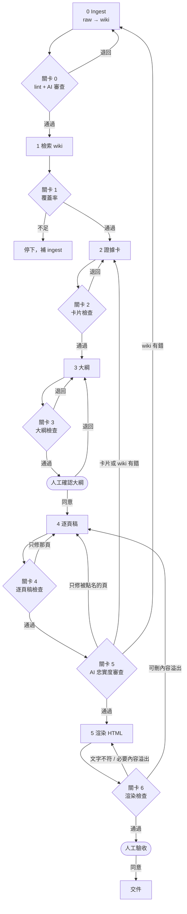

# 第 10 週作業：用 LLM Wiki 做一份教學 HTML 簡報

> 繳交標題：`學校 學號 系級 姓名 Context Engineering`（請自行填入）

本作業使用 Claude Code 作為 coding agent 完成。需求訪談的回答、大綱與成品的確認由我本人決定，建檔、ingest、檢查腳本與簡報由 AI 依 `AGENTS.md` 與 `workflow/topic-slides.md` 執行。

## 1. LLM Wiki 主題與簡介

**主題：Context Engineering（上下文工程）**，也就是「決定要把哪些資訊放到 AI 眼前」的工作。

這個 wiki 依 Karpathy 的 LLM Wiki 做法建立：`raw/` 放原始來源的摘錄，`wiki/` 放 AI 整理的筆記，`AGENTS.md` 是規則。讀者設定為修這門課的同學與老師。

建立方式是「先討論、後生成」：AI 先訪談我 10 個問題，整理成需求摘要讓我確認，之後才生成 `AGENTS.md` 與資料夾。訪談紀錄與「摘要 ↔ 手冊」的逐條對照在 [`interview.md`](interview.md)。

建 wiki 時特別考量的事：

- **出處可以用程式檢查**：概念頁每條說法結尾都有來源代號（如 `[S3]`），所以 lint 能逐條檢查。
- **數字不能編**：wiki 裡每個數字都必須能在該條引用的 `raw/` 檔案找到。
- **沒讀到的不引用**：有兩篇來源只讀到部分（S4 約前三分之二、S7 只有摘要），來源頁有註明，wiki 只用讀到的部分。
- **一次 ingest 一篇、一篇一個 commit**：git 歷程可以看到 wiki 怎麼長大。

## 2. LLM Wiki 成果

| 項目 | 位置 |
|---|---|
| 目錄 | [`wiki/index.md`](wiki/index.md) |
| 概念頁（12 頁） | [`wiki/concepts/`](wiki/concepts/) |
| 來源摘要頁（7 頁） | [`wiki/sources/`](wiki/sources/) |
| 原始摘錄（7 篇） | [`raw/`](raw/) |
| 規則（員工手冊） | [`AGENTS.md`](AGENTS.md) |
| 變更紀錄 | [`wiki/log.md`](wiki/log.md) |
| Lint 執行紀錄（每次 ingest 一筆） | [`logs/lint-history.md`](logs/lint-history.md) |

Ingest 的 7 篇來源：

| 代號 | 來源 | 讀到的範圍 |
|---|---|---|
| S1 | Simon Willison〈Context engineering〉（2025-06-27） | 全文 |
| S2 | LangChain〈Context Engineering〉（2025-07-02） | 全文 |
| S3 | 〈How Long Contexts Fail〉（dbreunig.com，2025-06-22） | 全文 |
| S4 | Chroma〈Context Rot〉技術報告（2025-07-14） | 約前三分之二 |
| S5 | Anthropic〈Effective context engineering for AI agents〉（2025-09-29） | 全文 |
| S6 | Manus〈Context Engineering for AI Agents〉（2025-07-18） | 全文 |
| S7 | 〈A Survey of Context Engineering for LLMs〉（arXiv 2507.13334） | 只有摘要 |

## 3. 教學 HTML 簡報

- 檔案：[`docs/index.html`](docs/index.html)（12 頁，用瀏覽器開啟；方向鍵或點擊換頁，可列印成 PDF）
- 教學結構：為什麼（第 2–5 頁）→ 是什麼（第 6–7 頁）→ 怎麼做（第 8–9 頁）→ 實務（第 10–11 頁）→ 總結（第 12 頁）
- 每一頁底部都有「出處」，連到對應的 wiki 頁面與來源頁。這一行不是手寫的，是渲染程式從該頁引用的證據卡自動產生的。

簡報每一頁和 wiki 的對應：

| 頁 | 標題 | 對應的 wiki 概念頁 | 來源 |
|---|---|---|---|
| 1 | Context Engineering 入門 | — | — |
| 2 | 資料給越多，AI 就越聰明嗎？ | `context-failure-modes.md`、`context-rot.md` | S3 S4 |
| 3 | 視窗是有限的工作記憶 | `context-window.md` | S2 S5 |
| 4 | 實驗證據：Context Rot | `context-rot.md` | S4 |
| 5 | 塞錯東西的四種下場 | `context-failure-modes.md` | S2 S3 |
| 6 | 四種定義放在一起看 | `what-is-context-engineering.md` | S1 S5 S7 |
| 7 | 和寫 Prompt 差在哪？ | `what-is-context-engineering.md` | S1 S5 |
| 8 | 好的上下文長什麼樣子？ | `designing-good-context.md` | S5 |
| 9 | 四種策略：存、取、縮、分 | `four-strategies.md` 與四個策略頁 | S2 S5 |
| 10 | 實戰：Manus 團隊的心得 | `production-lessons.md` | S6 |
| 11 | 各家強調的重點不同 | `what-is-context-engineering.md`、`designing-good-context.md`、`compress-context.md`、`production-lessons.md` | S1 S3 S5 S6 |
| 12 | 帶走三件事 | `context-window.md`、`designing-good-context.md`、`four-strategies.md`、`context-failure-modes.md` | S2 S3 S5 |

對應關係可以逐層追回去：簡報每頁 → [`drafts/`](topic-context-engineering/drafts/)（逐頁稿，標頭列出引用的卡片）→ [`cards/`](topic-context-engineering/cards/)（證據卡）→ `wiki/concepts/` → `raw/`。

## 4. Graph 設計

完整規格在 [`workflow/topic-slides.md`](workflow/topic-slides.md)。我選 graph 而不是單一 loop，因為各階段的檢查標準不同，而且出錯時只想重做出錯的那一格。



**資訊怎麼被取得、整理、檢查、再變成簡報**

| 階段 | 做什麼 | 產出 |
|---|---|---|
| 取得 | 上網抓 7 篇來源，存摘錄與網址 | `raw/` |
| 整理 | 一次 ingest 一篇，寫來源頁與概念頁，每條標出處 | `wiki/` |
| 查詢 | 讀 wiki 目錄，挑出和主題相關的頁面 | `sources.md` |
| 抽重點 | 一次只看一個 wiki 頁，抽出有編號、有出處的證據卡 | `cards/` |
| 排結構 | 用卡片排出大綱，人工確認 | `outline.md` |
| 寫內容 | 每頁只能用大綱指定的卡片 | `drafts/` |
| 產生簡報 | 程式把逐頁稿轉成 HTML，只排版不改字 | `docs/index.html` |

**哪些步驟會重複執行**

- 每個節點和它後面的關卡是一個小圈：產出 → 檢查 → 只修被點名的部分 → 再檢查。
- 逐頁稿以「頁」為單位重做：哪一頁有問題就只重寫那一頁。
- Ingest 每篇之後都跑一次 lint。

**哪些地方需要檢查或重新生成**

| 關卡 | 類型 | 檢查什麼 |
|---|---|---|
| 0 | 程式＋AI | wiki 的連結、出處、目錄、數字；wiki 是否忠於 raw（v2 新增） |
| 1 | 程式 | wiki 的內容夠不夠做簡報（概念頁 ≥ 3、來源 ≥ 5） |
| 2 | 程式 | 每張卡的出處與數字都在它的 wiki 頁裡 |
| 3 | 程式＋人 | 8–15 頁、教學順序正確；人工確認 |
| 4 | 程式 | 逐頁稿只用指定的卡片、數字都在卡片裡、沒超過字數 |
| 5 | AI | 新對話的子代理比對逐頁稿與來源，有沒有講錯、多講、講反 |
| 6 | 程式＋瀏覽器 | HTML 的字和逐頁稿一樣；實際開瀏覽器量有沒有溢出 |

**停止條件**：每個小圈最多修 2 輪；退回前面節點最多 3 次；wiki 內容不足就停下，不用模型自己的知識補。

**為什麼這樣設計**

- 每個節點只能看上一關的產出，所以簡報裡每句話都追得回 wiki 和 raw。
- 「做完了」由腳本決定，不是 AI 說了算。六支腳本都在 [`scripts/`](scripts/)。
- 渲染交給程式，排版時不可能順手改內容。
- 審查者是沒看過寫作過程的新對話，不讓作者審自己的作品。

## 5. 一次實際執行的結果與檢查紀錄

完整的逐筆紀錄在 [`topic-context-engineering/report.md`](topic-context-engineering/report.md)（腳本自動寫入，人工確認與 AI 審查另外註記）。摘要如下：

| 順序 | 關卡 | 結果 | 發生什麼事、怎麼處理 |
|---|---|---|---|
| 1 | Ingest 7 篇，每篇跑 lint | 7 次都 PASS | 另外做了一次反向測試：故意放進沒出處、假數字、假來源的句子，lint 都有抓到 |
| 2 | 關卡 1 覆蓋率 | PASS | 12 個概念頁、7 篇來源 |
| 3 | 關卡 2 證據卡 | PASS | 77 張卡 |
| 4 | 關卡 3 大綱（程式） | PASS | 15 頁 |
| 5 | **人工確認大綱** | **退回** | 我覺得 15 頁太長 → 退回大綱節點，合併成 12 頁（舊版留在 `outline-v1-rejected.md`） |
| 6 | 關卡 4 逐頁稿 | PASS | 12 頁 |
| 7 | **關卡 6 文字比對** | **FAIL** | 渲染程式在格狀版面把冒號刪掉了 → 修渲染程式 |
| 8 | **關卡 6 瀏覽器實測** | **FAIL** | 第 11 頁溢出；截圖發現第 5、9 頁永遠疊在別頁上面（腳本沒抓到）→ 修渲染程式，第 11 頁退回逐頁稿縮短，共修 2 輪 |
| 9 | **關卡 5 AI 審查** | **FAIL，6 頁** | 5 頁輕微（漏限定詞、標題不精確）、1 頁中等：第 11 頁的「專家沒有共識」是 wiki 自己把不同文章並排成對立 → **退回 wiki**，重抽 12 張卡，重寫 10 頁 |
| 10 | 關卡 4 逐頁稿（重寫後） | FAIL → PASS | 第 10 頁有一點超過字數，只修那一點 |
| 11 | 關卡 6 瀏覽器實測（重寫後） | FAIL → PASS | 第 11 頁又溢出，但這次內容必要 → 改修樣板 |
<!-- REVIEW2 -->

## 6. 反思

**哪一個節點最常出錯？**

以次數來說是**渲染節點**：冒號被刪、兩頁疊在一起、第 11 頁溢出三次，都發生在這裡。不過這些錯修起來很快，而且都在渲染關卡當場被抓到。

以代價來說是 **ingest（寫 wiki）這個節點**。AI 在整理多篇來源時，把「兩篇文章強調的重點不同」寫成了「兩種觀點互相對立」，例如把 Lütke 的「提供所有必要的上下文」和 Anthropic 的「最小的一組高訊號 token」寫成「給全部 vs 給最少」。這個錯在 ingest 時就發生了，但我的 lint 只檢查連結、出處、數字，檢查不到「意思有沒有被誇大」，所以一路通過，直到逐頁稿都寫完、進到 AI 審查才被發現。結果要從最後面退回最前面：改 wiki、重抽 12 張卡、重寫 10 頁、重新渲染。這就是課堂說的「大圈」。

**發現問題後，把檢查往前移到了哪一個步驟？**

把 **AI 忠實度審查從關卡 5（逐頁稿之後）往前移到 ingest**，成為新的關卡 0：wiki 一寫完，就請沒看過寫作過程的子代理逐條比對 wiki 和 `raw/`。這樣同一種錯誤會在源頭被抓到，只需要改一兩條 wiki，不會擴散到卡片和簡報。

另外一個小的前移：「兩頁疊在一起」原本要靠人看截圖才發現，我把它寫進瀏覽器檢查函式（`checkOverflow()` 增加「每次只顯示一頁」），變成程式檢查。

**有沒有因此修改 workflow / graph？為什麼？**

有，`workflow/topic-slides.md` 從 v1 改成 v2（git 歷程可以看到兩版），`AGENTS.md` 也跟著改：

1. 新增關卡 0（ingest 後的 AI 審查），並在 `AGENTS.md` 規定「不同觀點」只能用在來源真的互相反駁的時候。原因是這類錯誤離源頭越遠，修起來越貴。
2. 關卡 5 多了兩條退回路線（退回證據卡、退回 wiki）。v1 只畫了「退回逐頁稿」，但實際執行時發現錯誤可能出在更上游。
3. 版面溢出的退回路線分成兩條：內容可以刪就退回逐頁稿，內容必要就修樣板。v1 規定一律退回逐頁稿縮短，結果第 11 頁被迫刪掉一句重要的說明。

還沒解決的問題：關卡 4 的字數上限擋不住表格頁的溢出，因為表格的高度和字數不成比例，目前只能靠瀏覽器實測才知道。

其他心得：「先討論、後生成」的 `AGENTS.md` 比一句話生成的版本具體很多，因為訪談時就決定了「出處標到哪一篇」「數字要能在 raw 找到」，這兩條後來都變成可以用程式檢查的規則。

## 重現方式

```bash
python scripts/lint_wiki.py          # wiki 健康檢查
python scripts/check_coverage.py     # 關卡 1
python scripts/check_cards.py        # 關卡 2
python scripts/check_outline.py      # 關卡 3
python scripts/check_drafts.py       # 關卡 4
python scripts/render.py             # 產生 docs/index.html
python scripts/check_render.py       # 關卡 6（文字與出處）
# 版面：用瀏覽器開 docs/index.html，在 console 執行 window.checkOverflow()，回傳 [] 代表沒有溢出
```
