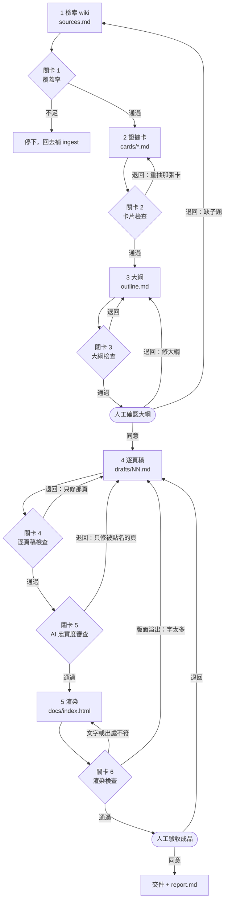

# Workflow：主題 → 教學 HTML 簡報（graph 規格 v1）

目標：只用 `wiki/` 的內容，產出一份 8–15 頁、讓沒學過的人看得懂的教學 HTML 簡報。
所有狀態都是檔案，放在 `topic-<主題>/`，每一關的產出都能打開看、放進 git、單獨重跑。

## 流程圖

## 節點規格

| 節點 | 只能看 | 產出 | 不能做 |
|---|---|---|---|
| 1 檢索 | `wiki/index.md` 與 wiki 頁面 | `sources.md`：相關頁面清單 | 讀 `raw/`、用模型自己的知識 |
| 2 證據卡 | 一次一個 wiki 概念頁 | `cards/<頁名>.md`：每張卡一條說法＋編號＋出處 | 混入其他頁面或其他來源的內容 |
| 3 大綱 | 證據卡 | `outline.md`：頁碼、教學階段、標題、目的、對應卡片 | 加入卡片以外的內容 |
| 4 逐頁稿 | 大綱＋該頁對應的卡片 | `drafts/NN.md` | 引用卡片以外的內容、出現卡片沒有的數字 |
| 5 渲染 | 已通過的逐頁稿 | `docs/index.html` | 改任何一個字（由 `render.py` 程式執行，頁尾出處自動從卡片產生） |
| 檢查關卡 | 成品＋它的來源 | 檢查結果，寫入 `report.md` | 自己動手改 |

## 檢查關卡

| 關卡 | 類型 | 通過條件 | 腳本 |
|---|---|---|---|
| 1 覆蓋率 | 程式 | 相關概念頁 ≥ 3、涵蓋來源 ≥ 5 | `check_coverage.py` |
| 2 證據卡 | 程式 | 每張卡有編號與出處；出處與數字都在它的 wiki 頁裡 | `check_cards.py` |
| 3 大綱 | 程式＋人 | 8–15 頁；每頁有卡片；教學階段順序正確；來源 ≥ 5；之後人工確認 | `check_outline.py` |
| 4 逐頁稿 | 程式 | 卡片與大綱一致；數字都在引用的卡片裡；沒有超過字數上限 | `check_drafts.py` |
| 5 忠實度 | AI 審查 | 開新對話的子代理，只拿到逐頁稿與引用的 wiki 頁，逐頁判斷有沒有講錯、講反、多講；只回報不修改 | 子代理 |
| 6 渲染 | 程式＋瀏覽器 | HTML 文字與逐頁稿一致、頁尾出處正確；瀏覽器實測沒有溢出、可以翻頁 | `check_render.py`、`window.checkOverflow()` |
| 人工驗收 | 人 | 看過成品後同意 | |

## 哪些步驟會重複（小圈）

- 節點 2、3、4、5 各自和後面的關卡形成小圈：「產出 → 檢查 → 只修被點名的部分 → 再檢查」。
- 逐頁稿的小圈以「頁」為單位：第 6 頁錯，只重寫第 6 頁，其他頁不動。

## 停止條件

- 每個小圈最多修 2 輪，第 3 次還不過就停下回報。
- 從後面關卡退回前面節點（大圈）整體最多 3 次。
- 關卡 1 不通過（wiki 內容不足）就直接停下，不用模型自己的知識補。

## 為什麼這樣設計

- 每個節點只看得到上一關的產出，內容的來源一路可以追回 wiki 與 `raw/`。
- 錯誤在離源頭最近的關卡被抓到，只重做出錯的那一格。
- 渲染交給程式，排版時不可能順手改內容。
- 審查者和作者分開，避免自己審自己的作品。
